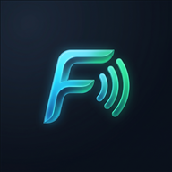
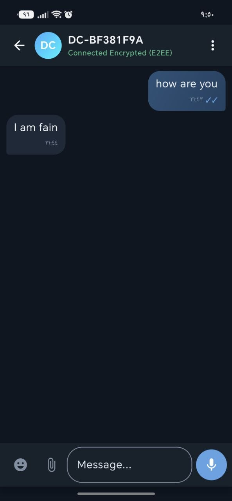
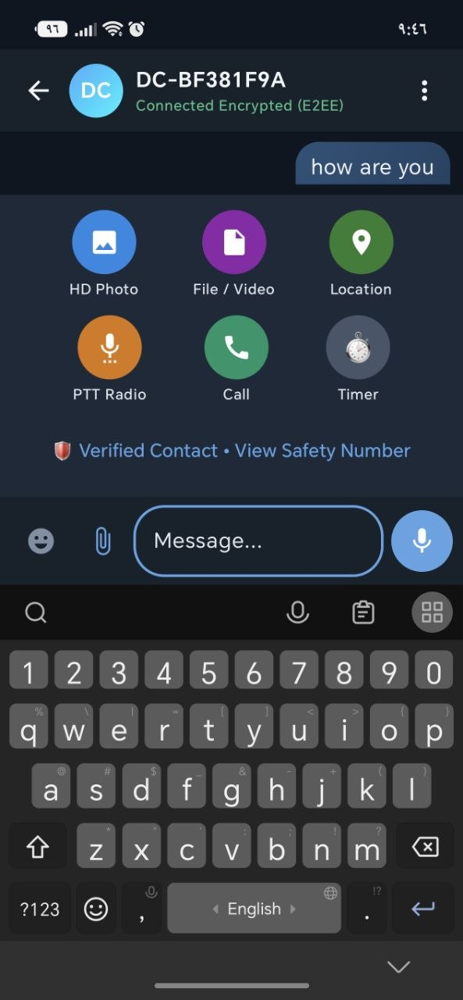
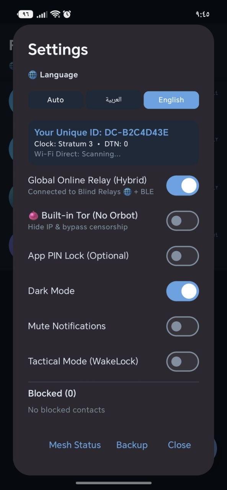
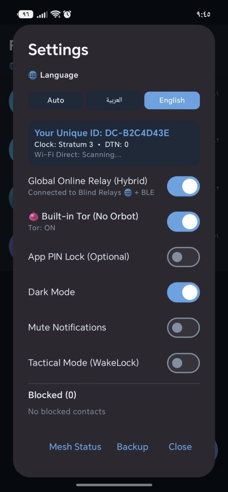

  

  
  
  
  

# Farlo — Hybrid Off-Grid & Decentralized E2EE Messenger

**Farlo** is an open-source, resilient Android + Rust messaging platform engineered to work seamlessly **with or without internet**. It combines a **Rust cryptographic & DTN core (`desertcomm-v3`)** with **BLE/Wi-Fi Direct multi-hop blind relaying** for off-grid environments and **NIP-59 Nostr Multi-Relay** + **WebRTC Opus** for global online communication.

## Core Features
- **True Off-Grid Multi-Hop Mesh (DTN Blind Relay)**: Messages are encrypted in Rust (`ChaCha20-Poly1305` / `X25519`), stored up to 24h, and silently relayed hop-by-hop across nearby Android devices via Bluetooth LE, Wi-Fi Direct, and LAN Mesh without intermediary devices ever seeing sender, recipient, or content.
- **Decentralized Global Transport (NIP-59 Nostr Multi-Relay)**: Zero-dependency pure-Kotlin BIP-340 Schnorr (Jacobian `secp256k1`) broadcasting across multiple independent Nostr relays (`kind = 1059`) with optional Self-Hosted Relay (`docker-compose.yml`).
- **Encrypted Media, Voice & Calls**:
  - E2EE HD Photos (pre-send preview, auto-download, pinch-to-zoom), Files & Videos (native Open/Save/Share via `FileProvider`).
  - 24-bar interactive acoustic waveform player with seek & `1.0x / 1.5x / 2.0x` playback speed.
  - Hold-to-Talk Walkie-Talkie (`PTT`) for 1-to-1 and Group chats (online & offline BLE).
  - Encrypted WebRTC (`Opus` + `DTLS-SRTP`) voice calls with proximity sensor support.
- **Built-in Tor (Zero Orbot Required)**: One-tap embedded Tor (	or-android) directly inside Settings to hide IP metadata and bypass censorship.
- **Privacy & Security**: 30-digit **Safety Number** verification, native **Biometric Unlock**, **Duress PIN (`0000`)** empty decoy mode, **Disappearing Messages**, and cross-device **PBKDF2 + ChaCha20-Poly1305 Encrypted Backups (`.sadaenc`)**.
- **Multilingual**: Automatic system language + live in-app switcher (**Arabic RTL, English, French, Spanish, German**).

## Repository Structure
- `desertcomm-v3/` — 8-crate Rust cryptographic, RaptorQ FEC, and DTN bundle store (`arm64-v8a`).
- `app-android/` — Jetpack Compose Android client (`minSdk 26`, R8 optimized).
- `sada-server/` — One-command Docker Compose kit (`ntfy` + `nostr-rs-relay` + `coturn`).

## Build Instructions
1. Build Rust core (`arm64-v8a`) with `cargo-ndk` into `app-android/app/src/main/jniLibs/arm64-v8a/libdesertcomm_v3.so`.
2. Run `./gradlew assembleDebug` (or configure `local.properties` for signed `assembleRelease`).

## Security Status (Public Beta)

Farlo v4.7 is an open-source **Public Beta** released for community testing and security review. It has **not yet undergone an independent third-party cryptographic audit**. For responsible disclosure and threat-model details, see `SECURITY.md`.

## Roadmap (v5.0 & Beyond)

- **Cryptographic Upgrades**: Double Ratchet (Forward Secrecy & Post-Compromise Security) + ML-KEM (Kyber) post-quantum key exchange inside the Rust core, and strict key-exchange enforcement prior to first message.
- **Decentralized Media**: Migration to Nostr **Blossom** servers for censorship-resistant encrypted media hosting.
- **Cross-Platform**: iOS client sharing the same Rust cryptographic core via `UniFFI`.
- **Off-Grid Expansion**: BLE-to-Internet blind gateway relays and optional **LoRa / Codec2** ultra-low-bitrate radio transport.
- **Optional Privacy Ecosystem Integrations**: Exploring optional private peer-to-peer payments (e.g., Firo Lelantus Spark / Spark Names) while keeping Farlo 100% self-contained with zero external helper apps.